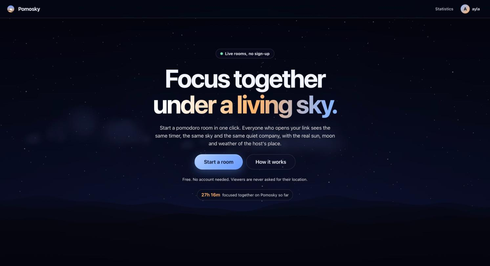
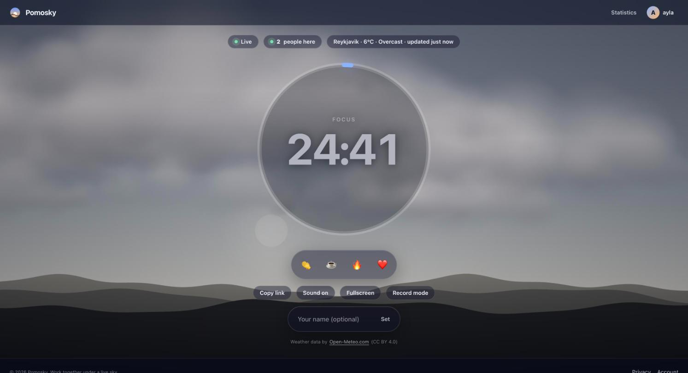
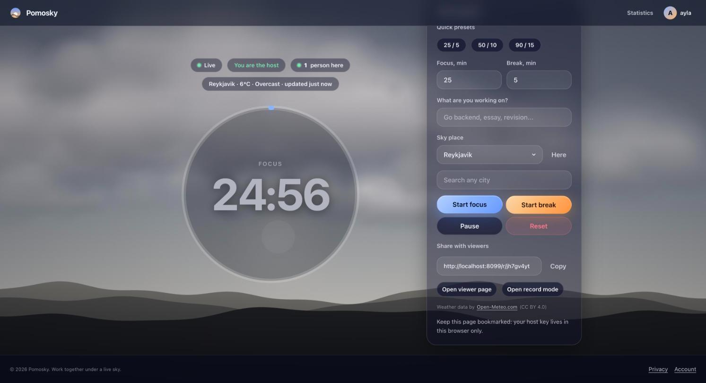
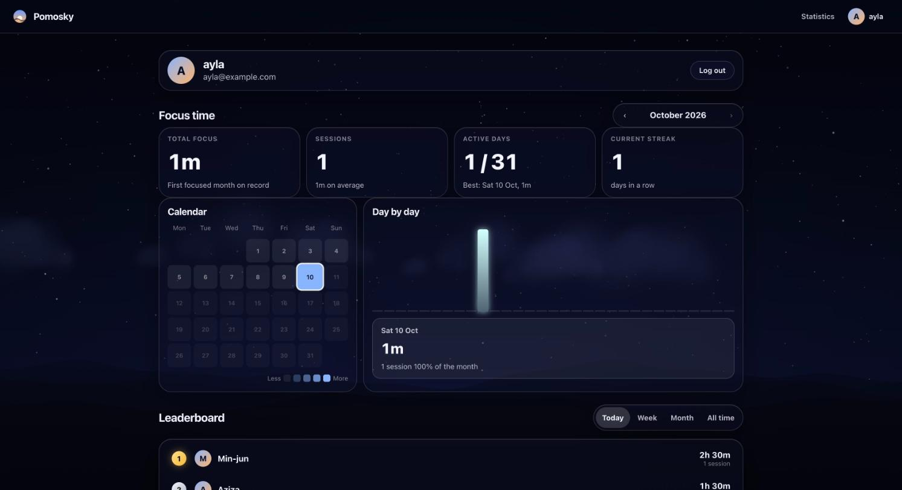

# Pomosky

**Pomodoro + sky.** A host runs a shared pomodoro timer, viewers join with a link and work together
in silence. The sky behind the room is drawn from the real sun, moon and weather at the host's place.

No chat, no sign-up needed to host or watch. Logging in is optional and only adds your own statistics.

## Screenshots

| Landing | Room (viewer) |
|---|---|
|  |  |

| Host panel | Statistics and leaderboard |
|---|---|
|  |  |

(The statistics screenshot uses made-up demo accounts.)

## What it does

- **Rooms:** one click creates a room. The server owns the timer, so every device shows the same second,
  also after a reconnect. Focus and break phases, pause, resume, reset, a label, silent reactions
  (clap, coffee, fire, heart) and a live "N people here" counter.
- **Living sky:** a Canvas 2D sky with real sun and moon positions, clouds, rain, snow, fog, wind and
  lightning. The weather comes from [Open-Meteo](https://open-meteo.com/) for the host's rounded place.
- **Record mode:** a clean 9:16 view with a local QR code, for screen recordings and streams.
- **Statistics (optional login):** monthly focus time with a calendar, daily bars, streak, a selectable day,
  community totals (today, 7 days, month, all time) and a leaderboard.
- **Login:** Google or an emailed one-time link. Public profile settings (name, hide from leaderboard) and
  account deletion.
- **Admin page:** live rooms, totals, 30-day charts, users and system health, visible to operators only.
- **Mobile first:** every page is built for phones first, with soft motion that respects
  `prefers-reduced-motion`.

## How it works

```
 viewer / host browser                       Go server
 ---------------------                       ------------------------------------------
 GET /r/{id}            --- HTML (SSR) --->  controllers -> views (html/template)
 WebSocket /ws/{id}     <-- state, ticks -->  realtime.Handler -> RoomHub -> room.Reduce (pure)
 GET /api/weather       --- JSON, cached -->  weather.Service -> Open-Meteo
 GET /api/stats/...     --- JSON ---------->  stats.Service -> PostgreSQL (focus sessions)
```

- **The server owns the timer.** It stores only `startedAt` and `duration`. Each browser works out the remaining
  time from those and a clock offset measured with `ping`/`pong`, so nothing ticks over the network.
- **Rooms live in memory.** Every change goes through the pure `room.Reduce` function and is broadcast to the
  connected clients. Slow clients are dropped from a broadcast instead of blocking the room.
- **Focus time is recorded when a focus phase ends** (reset, a new start, or the timer running out). Pauses are not
  counted and sessions under 30 seconds are ignored.
- **The host token** is random, shown once in the URL fragment (never sent to the server in a request), and only
  its salted hash is stored.

### WebSocket messages (short)

| Direction | Messages |
|---|---|
| Client to server | `join`, `host.auth`, `timer.start`, `timer.pause`, `timer.resume`, `timer.reset`, `location.set`, `reaction`, `ping` |
| Server to client | `state`, `host.ok`, `reaction.tick`, `pong`, `error` |

Full protocol: [docs/ws-protocol.md](docs/ws-protocol.md). HTTP routes and JSON shapes: [docs/api.md](docs/api.md).

## Tech

| Part | Choice |
|---|---|
| Server and pages | Go, server-side rendering with `html/template`, MVC with a pure core |
| Realtime | WebSocket (`coder/websocket`), server-authoritative timer |
| Frontend | TypeScript modules without a framework, bundled with Vite |
| Database | PostgreSQL (`pgx`, `sqlc`, `goose`) |
| Weather | Open-Meteo forecast and geocoding APIs, cached on the server |
| Hosting | Any Linux server: Docker Compose with Caddy, or a Docker-free install with systemd |

The room logic is a pure function (`room.Reduce(state, event, now)`), and the dependency rules between
packages are enforced by a test (`internal/archtest`). See [docs/architecture.md](docs/architecture.md).

## Quick start

Requirements: Go (version in `go.mod`) and Node 22. PostgreSQL is optional locally.

```bash
cp .env.example .env     # optional, the defaults work
make dev                 # http://localhost:8080
```

`make dev` rebuilds the Go server when Go files or `.env` change, rebuilds the frontend, reads templates from
disk and reloads the browser. Change the port with `ADDR=:8081 make dev`.

**Without a database** the server still runs: anonymous rooms, the timer, reactions, record mode and weather all work.
**With a database** you also get login, saved rooms, statistics, the leaderboard and the admin page. Set
`DATABASE_URL` in `.env`; migrations are applied when the server starts.

Login locally: in development, email sign-in links are printed in the server log. Google sign-in needs
`OAUTH_GOOGLE_CLIENT_ID` and `OAUTH_GOOGLE_CLIENT_SECRET` (redirect URI: `BASE_URL/auth/google/callback`).
To open `/admin`, put your email in `ADMIN_EMAILS` and log in with it.

Every setting is described in [docs/env.md](docs/env.md).

## Commands

| Command | What |
|---|---|
| `make dev` | Live development (see above) |
| `make run` | Build the frontend once, then run the server |
| `make test` | Go tests |
| `make test-db` | Go tests including the PostgreSQL ones (set `TEST_DATABASE_URL`, use a throwaway database) |
| `make vet`, `make fmt` | Static checks and formatting |
| `make sqlc` | Regenerate the database code after changing `internal/store/postgres/queries/` |
| `cd web && npm test` | Frontend unit tests (Vitest) |
| `cd web && npx tsc --noEmit` | Type check the frontend |

Development helpers, available only with `DEV_RELOAD=true`: `/__dev/sky` (sky lab with sliders for time and weather)
and `/__dev/mobile?path=/account&w=390` (a page in a phone-sized frame).

## Project layout

```
cmd/server/          entry point
internal/room/       pure room core (state, events, reducer)
internal/realtime/   WebSocket hub and protocol
internal/controllers/ HTTP handlers (thin)
internal/views/      html/template pages and partials
internal/auth/       sessions, magic links, Google
internal/stats/      monthly, community and leaderboard statistics
internal/admin/      data for the admin page
internal/weather/    weather service and the Open-Meteo adapter
internal/store/postgres/  repositories (sqlc)
internal/app/        composition root and routes
migrations/          goose SQL migrations
web/src/             TypeScript, sky engine, CSS
deploy/              Docker Compose, Caddy, Docker-free scripts
docs/                plan, architecture, protocol, API, runbook, decisions
```

## Deploy

Two options, both in [docs/runbook.md](docs/runbook.md):

- **Docker Compose** (`deploy/docker-compose.yml`): app, Caddy with automatic HTTPS, PostgreSQL.
- **Without Docker** (`deploy/bare/`): `install.sh` sets up PostgreSQL, Caddy and a systemd service on a fresh
  Ubuntu server, `release.sh` builds on your computer and installs, `backup.sh` dumps the database.
  This suits small or free servers.

`deploy/scripts/init-env.sh` creates a production `.env` with random secrets.

## Privacy and terms

- Viewers are never asked for a location. The host's place is stored rounded to about 1 km.
- Rooms live in memory and disappear shortly after everyone leaves. Only logged-in hosts have a stored room.
- Focus time of rooms hosted without an account is kept only as start time and length, for the community totals.
- The leaderboard shows a public name and picture, never an email. Users can change the name or hide themselves.
- See [the privacy page](internal/views/templates/pages/privacy.html) for the exact wording.
- **Weather data: [Open-Meteo.com](https://open-meteo.com/), CC BY 4.0.** The free Open-Meteo API is for
  non-commercial use only. Pages that show weather credit it. A commercial product needs their paid plan.

## Troubleshooting

| Problem | What to check |
|---|---|
| "Continue with Google" does nothing or says access blocked | The Google app is in Testing mode: add your Gmail under Audience, Test users. The redirect URI must match `BASE_URL/auth/google/callback` exactly. |
| `/admin` shows "Page not found" | You must be logged in with an email listed in `ADMIN_EMAILS`. The server reads `.env` only at start (`make dev` restarts on `.env` changes). |
| No login option at all | Login needs `DATABASE_URL`. Without it the server runs anonymously. |
| Email sign-in link does not arrive in development | It is printed in the server log, not sent. Set `SMTP_*` to really send it. |
| The sky is plain or the weather chip is missing | The host has not chosen a place yet (host panel, "Sky place"). |
| Port 8080 is busy | `ADDR=:8081 make dev`. |
| Database tests are skipped | Set `TEST_DATABASE_URL` to a throwaway database and run `make test-db`. |
| Old styles or scripts after an update | Hard-reload the page. Development serves assets with `no-cache`. |

## Status

Built and tested: rooms and the realtime timer, the living sky with real weather, record mode, optional login,
statistics, the leaderboard and the admin page. Not done yet: the first production deploy (see the runbook),
publishing the Google app to everyone, and a license. The plan and the history of decisions are in [docs/](docs/).

## Documentation

[docs/README.md](docs/README.md) lists everything: [plan](docs/plan.md), [architecture](docs/architecture.md),
[WebSocket protocol](docs/ws-protocol.md), [HTTP routes and JSON](docs/api.md), [environment](docs/env.md),
[runbook](docs/runbook.md) and the [decision records](docs/decisions/).

## Contributing

Small commits, one concern each, in Conventional Commits style (`feat(scope): subject`).
Run `gofmt -l .`, `go vet ./...`, `go test ./...` and `cd web && npx tsc --noEmit && npm test` before committing.
The architecture test must pass. Never commit `.env`, keys or tokens.

## License

Not chosen yet. Until a license file is added, all rights are reserved.
